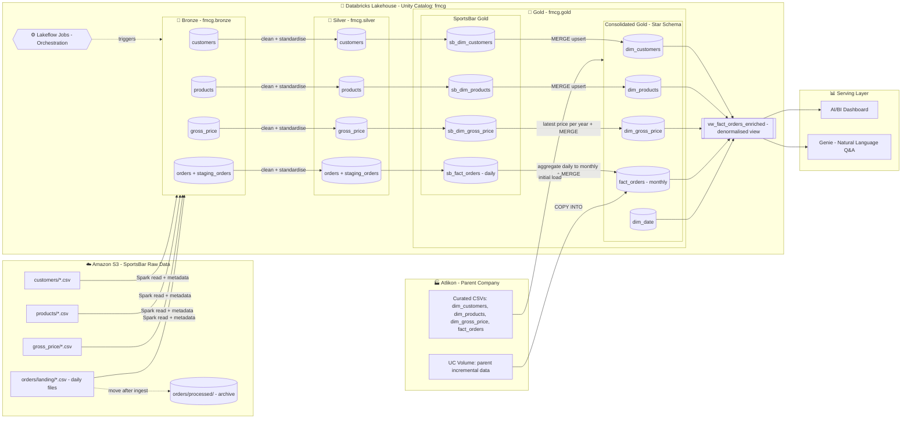
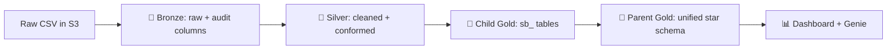
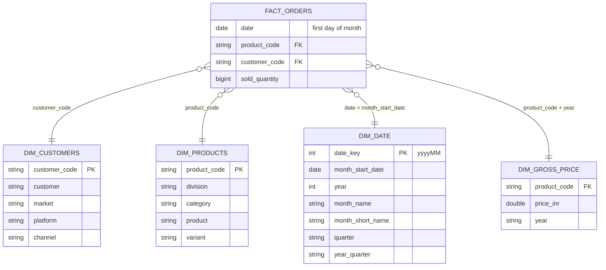
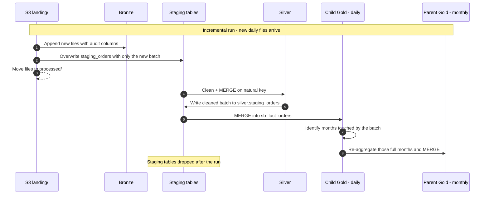
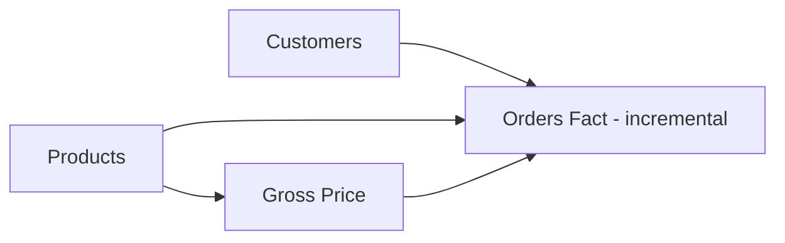
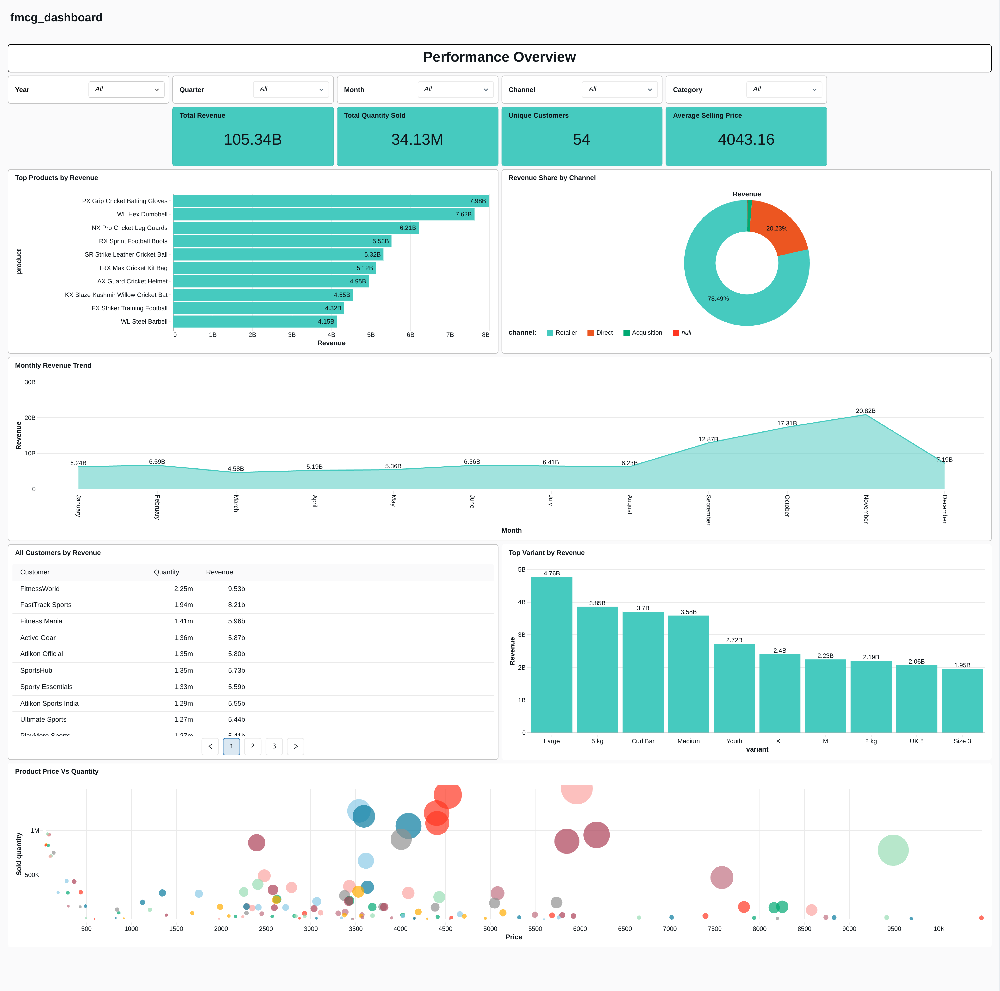

<div align="center">

# 🏬 FMCG Retail Data Consolidation Lakehouse ETL Analytics Pipeline

### Post-Acquisition Data Integration on Databricks using the Medallion Architecture


</div>

---

## 📌 Table of Contents

1. [Business Context](#-business-context)
2. [Problem Statement](#-problem-statement)
3. [Solution Overview](#-solution-overview)
4. [Data Architecture](#-data-architecture)
5. [Tech Stack](#-tech-stack)
6. [Source Data](#-source-data)
7. [Data Model (Gold Layer)](#-data-model-gold-layer)
8. [Pipeline Walkthrough](#-pipeline-walkthrough)
9. [Data Quality Issues & How They Were Resolved](#-data-quality-issues--how-they-were-resolved)
10. [Full Load vs. Incremental Load](#-full-load-vs-incremental-load)
11. [Orchestration](#-orchestration)
12. [Analytics & Dashboard](#-analytics--dashboard)
13. [Repository Structure](#-repository-structure)
14. [How to Run](#-how-to-run)
15. [Key Engineering Decisions](#-key-engineering-decisions)
16. [Skills Demonstrated](#-skills-demonstrated)

---

## 🏢 Business Context

**Atlikon** is a well-established Indian **sports equipment manufacturer** (cricket, football, archery, fitness, etc.) selling through retailers and direct channels on both brick-and-mortar and e-commerce platforms. Atlikon already runs a mature, well-modelled analytics stack.

Atlikon recently **acquired SportsBar**, a fast-growing **sports-nutrition startup** (energy bars, protein bars, electrolyte mixes, recovery dairy, etc.). Unlike its parent, SportsBar has **no proper data platform**: its order, product, customer and pricing data are exported as raw CSV files into an S3 bucket — inconsistent, duplicated and full of quality problems.

Leadership wants a **single source of truth** so that the combined business (parent + acquired company) can be analysed in **one consolidated dashboard**.

| | 🏭 Parent Company — Atlikon | 🥤 Child Company — SportsBar |
|---|---|---|
| **Domain** | Sports equipment | Sports nutrition (FMCG) |
| **Data maturity** | Clean, modelled star schema | Raw, messy CSV exports |
| **Fact grain** | Monthly | Daily |
| **Product key** | Alphanumeric `product_code` | Numeric `product_id` |
| **Pricing grain** | Yearly price per product | Monthly price per product |
| **Customer attributes** | `customer, market, platform, channel` | `customer_name, city` |

---

## ❓ Problem Statement

> *"How do we bring an acquired company's unreliable raw data up to the parent company's standards and merge it into a single analytical model — without breaking existing reporting, and in a way that keeps working as new data arrives every day?"*

Concretely, the platform had to:

- Ingest SportsBar's raw files from **Amazon S3** in a repeatable, auditable way.
- **Clean and standardise** dirty data (duplicates, typos, mixed date formats, invalid IDs, negative/non-numeric prices…).
- **Conform** SportsBar's schema, keys and grain to Atlikon's existing gold data model.
- **Merge** both companies into shared gold tables using idempotent **upserts**.
- Support both a **historical (full) load** and **daily incremental loads**.
- Serve a **consolidated BI dashboard** and enable natural-language querying.

---

## 💡 Solution Overview

A **Lakehouse** was built on **Databricks** with **Unity Catalog** governance and **Delta Lake** storage, following the **Medallion Architecture**:

- **Bronze** – raw SportsBar files landed as-is with ingestion metadata (timestamp, file name, file size).
- **Silver** – cleaned, de-duplicated, type-cast and standardised data, conformed to the parent data model.
- **Gold** – business-ready child tables (`sb_*`) that are then **MERGEd into the parent's gold tables**, producing one unified star schema.
- **Serving** – a denormalised SQL view powers a **Databricks AI/BI Dashboard** and **Genie** (natural-language Q&A).

All pipelines are parameterised notebooks orchestrated with **Databricks Lakeflow Jobs**.

---

## 🏗 Data Architecture



### High-level flow



---

## 🧰 Tech Stack

| Layer | Technology | Purpose |
|---|---|---|
| Storage (raw) | **Amazon S3** | Landing zone for SportsBar CSV files + archive (`processed/`) |
| Compute | **Databricks** (Spark) | Distributed data processing |
| Table format | **Delta Lake** | ACID tables, `MERGE` upserts, Change Data Feed, schema evolution |
| Governance | **Unity Catalog** | `fmcg` catalog with `bronze` / `silver` / `gold` schemas, Volumes |
| Transformation | **PySpark**, **Spark SQL** | Cleaning, conforming, aggregation, upserts |
| Orchestration | **Databricks Lakeflow Jobs** | Scheduling and dependency management of notebooks |
| BI / Serving | **Databricks AI/BI Dashboards**, **Genie** | Consolidated reporting and natural-language analytics |

---

## 🗂 Source Data

### 🏭 Parent company (Atlikon) — `Data/1_parent_company/`

| File | Rows | Description |
|---|---:|---|
| `dim_customers.csv` | 18 | Customer, market, platform (Brick & Mortar / E-Commerce), channel (Retailer / Direct) |
| `dim_products.csv` | 397 | Product hierarchy across 25 sports divisions |
| `dim_gross_price.csv` | 794 | Yearly price (INR) per product |
| `fact_orders.csv` (full load) | ~93K | **Monthly** sold quantity, Jan 2024 → Nov 2025 |
| `fact_orders.csv` (incremental) | ~4.5K | December 2025 orders, loaded via `COPY INTO` |

### 🥤 Child company (SportsBar) — `Data/2_child_company/`

| Dataset | Files | Description |
|---|---:|---|
| `customers` | 1 | `customer_id, customer_name, city` |
| `products` | 1 | `product_name, product_id, category` |
| `gross_price` | 1 | `product_id, month, gross_price` (monthly) |
| `orders` (full load) | 152 daily files | Jul 1 → Nov 30, 2025 |
| `orders` (incremental) | 30 daily files | Dec 1 → Dec 30, 2025 |

In total, **~61.8K raw SportsBar order lines** across **182 daily files** were processed.

---

## ⭐ Data Model (Gold Layer)

The consolidated gold layer is a **star schema** at **monthly grain**. SportsBar data is conformed and merged into these tables, so downstream consumers see a single model.



### Serving view — `fmcg.gold.vw_fact_orders_enriched`

A denormalised view ([`denormalise_table_query_fmcg.txt`](Dashboard/denormalise_table_query_fmcg.txt)) joins the fact with all dimensions and derives revenue, giving the dashboard and Genie a single flat, business-friendly table:

```sql
(fo.sold_quantity * gp.price_inr) AS total_amount_inr
...
LEFT JOIN fmcg.gold.dim_gross_price gp
       ON fo.product_code = gp.product_code
      AND YEAR(fo.date)   = gp.year
```

---

## 🔄 Pipeline Walkthrough

### 1️⃣ Setup — `Codes/1_setup/`

| Notebook | What it does |
|---|---|
| [`setup_catalog.ipynb`](Codes/1_setup/setup_catalog.ipynb) | Creates the `fmcg` Unity Catalog and the `bronze`, `silver`, `gold` schemas |
| [`utilities.ipynb`](Codes/1_setup/utilities.ipynb) | Shared schema-name variables, imported by every pipeline via `%run` |
| [`dim_date_table_creation.ipynb`](Codes/1_setup/dim_date_table_creation.ipynb) | Generates a **monthly** date dimension (Jan 2024 → Dec 2025) with `date_key (yyyyMM)`, year, month, quarter and year-quarter |

### 2️⃣ Dimension processing — `Codes/2_dimension_data_processing/`

Each notebook is **parameterised with widgets** (`catalog`, `data_source`) and follows the same Bronze → Silver → Gold → Merge pattern.

**👥 Customers** — [`1_customers_data_processing.ipynb`](Codes/2_dimension_data_processing/1_customers_data_processing.ipynb)
- De-duplicates on `customer_id`, trims whitespace, title-cases names.
- Fixes city typos through a mapping dictionary and whitelists valid cities.
- Back-fills missing cities using **business-confirmed** corrections.
- Conforms to the parent model: builds `customer = "Name-City"` and adds `market = India`, `platform = Sports Bar`, `channel = Acquisition`.
- `MERGE`s into `fmcg.gold.dim_customers` on `customer_code`.

**📦 Products** — [`2_products_data_processing.ipynb`](Codes/2_dimension_data_processing/2_products_data_processing.ipynb)
- De-duplicates, title-cases categories, fixes the `Protien → Protein` misspelling.
- Derives a parent-style **`division`** from category and extracts **`variant`** (e.g. `60g`) from the product name via regex.
- Generates a deterministic surrogate **`product_code = SHA-256(product_name)`** to fit the parent's key system.
- Replaces non-numeric `product_id`s with a fallback (`999999`) so no fact rows are lost.
- `MERGE`s into `fmcg.gold.dim_products` on `product_code`.

**💰 Gross Price** — [`3_pricing_data_processing.ipynb`](Codes/2_dimension_data_processing/3_pricing_data_processing.ipynb)
- Parses `month` from **4 different date formats** using `coalesce(try_to_date(...))`.
- Validates `gross_price`: negative values → absolute value, non-numeric values (e.g. `unknown`) → `0`.
- Joins with silver products to obtain `product_code`.
- Converts **monthly → yearly** pricing with a window function: per `(product_code, year)` it picks the **latest non-zero price**.
- `MERGE`s into `fmcg.gold.dim_gross_price`.

### 3️⃣ Fact processing — `Codes/3_fact_data_processing/`

**📑 Orders** — [`1_full_load_fact.ipynb`](Codes/3_fact_data_processing/1_full_load_fact.ipynb) & [`2_incremental_load_fact.ipynb`](Codes/3_fact_data_processing/2_incremental_load_fact.ipynb)
- Reads all daily files from `s3://.../orders/landing/`, appends to Bronze with audit columns, then **moves files to `processed/`** so they are never ingested twice.
- Silver cleaning: drops rows with null quantity, sanitises invalid `customer_id`s, strips weekday prefixes and parses **4 date formats**, removes duplicates, joins products to get `product_code`.
- Upserts into Silver and child Gold (`sb_fact_orders`) at **daily grain**.
- **Aggregates daily → monthly** (`trunc(date, 'MM')`, `SUM(sold_quantity)`) to match the parent grain and `MERGE`s into `fmcg.gold.fact_orders`.

---

## 🧹 Data Quality Issues & How They Were Resolved

| # | Dataset | Issue found in raw data | Resolution |
|---|---|---|---|
| 1 | Customers | Duplicate `customer_id`s | `dropDuplicates(['customer_id'])` |
| 2 | Customers | Leading/trailing spaces, inconsistent casing | `trim()` + `initcap()` |
| 3 | Customers | City typos (`Bengaluruu`, `Bengalore`, `Hyderbad`, `NewDheli`, …) | Mapping dictionary + allowed-values whitelist |
| 4 | Customers | Missing cities | Back-filled with business-confirmed values |
| 5 | Products | Lower-case categories (`energy bars`) | `initcap()` |
| 6 | Products | Misspelling `Protien` | Case-insensitive `regexp_replace` |
| 7 | Products | Non-numeric `product_id` | Fallback ID `999999` to keep referential integrity |
| 8 | Products | No key compatible with parent | Deterministic SHA-256 `product_code` |
| 9 | Gross Price | Mixed date formats (`2025/07/01`, `01/08/2025`, …) | `coalesce` over multiple `try_to_date` formats |
| 10 | Gross Price | Negative prices (`-84`) and text (`unknown`) | Absolute value / default to `0`; zero prices de-prioritised |
| 11 | Orders | Dates like `"Wednesday, July 02, 2025"`, `08/07/2025`, `06-12-2025` | Regex weekday removal + multi-format parsing |
| 12 | Orders | Invalid customer IDs (`XYZ123`, `INVALID`) | Replaced with `999999` |
| 13 | Orders | Unknown product IDs (`99999999`, `77777777`) | Filtered out via inner join with products |
| 14 | Orders | Missing `order_qty` | Rows dropped |
| 15 | Orders | Duplicate order lines | `dropDuplicates` on the natural key |
| 16 | Orders | Daily grain vs parent monthly grain | Aggregated to month-start before merge |

---

## ⏱ Full Load vs. Incremental Load



| | Full (historical) load | Incremental load |
|---|---|---|
| Input | 152 daily files (Jul–Nov 2025) | New daily files (Dec 2025) |
| Bronze | Append | Append **+ staging table** of the new batch only |
| Transform scope | Entire Bronze table | **Only the staging batch** |
| Parent merge | Aggregate all child data to months | **Re-aggregate only affected months** from child gold, so partial months stay correct |
| Idempotency | `MERGE` on `(date, product_code, customer_code)` | Same — reruns never double-count |
| Cleanup | — | Drop `bronze.staging_orders` & `silver.staging_orders` |

**Why re-aggregate whole months?** Daily SportsBar files arrive mid-month. Summing only the new batch and upserting would *overwrite* the month's previous total. Instead, the pipeline recalculates the **complete month** from the daily child gold table and upserts that — always producing the correct monthly figure.

The parent company's incremental data is loaded with an idempotent `COPY INTO` from a Unity Catalog Volume ([query](Data/1_parent_company/incremental_load/incremental_data_parent_company_query.txt)).

---

## ⚙️ Orchestration

The notebooks are chained in a **Databricks Lakeflow Job** so that dimensions are always refreshed before the fact table that depends on them:



- Products runs before Gross Price and Orders because both rely on `silver.products` for `product_code` lookups.
- Each task passes `catalog` and `data_source` as **job parameters** to the widget-driven notebooks, so the same code can target other catalogs/environments.

---

## 📊 Analytics & Dashboard

The consolidated gold layer feeds a **Databricks AI/BI Dashboard** — *Performance Overview* — with filters for **Year, Quarter, Month, Channel and Category**.

📄 **[View the full dashboard (PDF)](Dashboard/fmcg_dashboard.pdf)**

[](Dashboard/fmcg_dashboard.pdf)

### Headline KPIs (combined business)

| Total Revenue | Total Quantity Sold | Unique Customers | Avg. Selling Price |
|:---:|:---:|:---:|:---:|
| **₹105.34B** | **34.13M units** | **54** | **₹4,043.16** |

### Key insights

- 📈 **Strong H2 seasonality** — monthly revenue holds around ₹4.6B–6.6B through August, then climbs sharply to a peak of **₹20.82B in November**, driven by the festive season.
- 🏪 **Retailers dominate** with **78.5%** of revenue, Direct contributes **20.2%**, while the newly integrated **Acquisition** channel (SportsBar) is now visible as its own segment — ready to be tracked as it grows.
- 🏏 **Cricket leads the product mix** — *PX Grip Cricket Batting Gloves* (₹7.98B) and other cricket gear take 5 of the top 10 product spots.
- 🧍 **Customer concentration** — *FitnessWorld* (₹9.53B) and *FastTrack Sports* (₹8.21B) are the two largest accounts.
- 💬 **Genie** is enabled on the gold view so business users can ask questions such as *"What was SportsBar's revenue in December?"* in plain English.

---

## 📁 Repository Structure

```
Retail_Data_Consolidation_Lakehouse/
├── Codes/
│   ├── 1_setup/
│   │   ├── setup_catalog.ipynb              # Catalog & schema creation
│   │   ├── utilities.ipynb                  # Shared config variables
│   │   └── dim_date_table_creation.ipynb    # Monthly date dimension
│   ├── 2_dimension_data_processing/
│   │   ├── 1_customers_data_processing.ipynb
│   │   ├── 2_products_data_processing.ipynb
│   │   └── 3_pricing_data_processing.ipynb
│   └── 3_fact_data_processing/
│       ├── 1_full_load_fact.ipynb           # Historical load
│       └── 2_incremental_load_fact.ipynb    # Daily incremental load
├── Data/
│   ├── 1_parent_company/                    # Atlikon (clean, monthly)
│   │   ├── full_load/
│   │   └── incremental_load/
│   └── 2_child_company/                     # SportsBar (raw, daily)
│       ├── full_load/
│       └── incremental_load/
├── Dashboard/
│   ├── fmcg_dashboard.pdf                   # Exported dashboard
│   ├── fmcg_dashboard.png                   # Dashboard preview
│   └── denormalise_table_query_fmcg.txt     # Serving view DDL
├── Resources/
│   ├── project_architecture.png
│   └── databricks_project.excalidraw
└── README.md
```

---

## 🚀 How to Run

1. **Prerequisites**
   - A Databricks workspace with Unity Catalog enabled (Free Edition works).
   - An S3 bucket connected to Databricks via an External Location / Storage Credential.

2. **Upload the source data**
   - Upload SportsBar files to S3 using this layout:
     ```
     s3://<your-bucket>/customers/customers.csv
     s3://<your-bucket>/products/products.csv
     s3://<your-bucket>/gross_price/gross_price.csv
     s3://<your-bucket>/orders/landing/orders_YYYY_MM_DD.csv
     ```
   - Update `base_path` in the notebooks if your bucket name differs.

3. **Set up the catalog**
   - Import the `Codes/` folder into your workspace (e.g. `/Workspace/consolidated_pipeline/`).
   - Run `setup_catalog.ipynb`, then `dim_date_table_creation.ipynb`.
   - Load the parent company CSVs from `Data/1_parent_company/full_load/` into `fmcg.gold` (`dim_customers`, `dim_products`, `dim_gross_price`, `fact_orders`).

4. **Run the pipelines**
   - Dimensions: `1_customers` → `2_products` → `3_pricing`.
   - Fact: `1_full_load_fact.ipynb` for history.
   - Drop new daily files into `orders/landing/` and run `2_incremental_load_fact.ipynb` (or schedule it as a Lakeflow Job).

5. **Serve**
   - Create the view in `Dashboard/denormalise_table_query_fmcg.txt`, then build the dashboard / Genie space on top of it.

---

## 🧠 Key Engineering Decisions

| Decision | Rationale |
|---|---|
| **Medallion architecture** for the child company only | Parent data was already curated; the raw child data needed staged refinement and auditability |
| **Delta `MERGE` everywhere** in gold | Idempotent, re-runnable pipelines with no duplicates |
| **Change Data Feed enabled** on all tables | Enables downstream CDC consumers and auditing |
| **File archiving** (`landing/ → processed/`) | Simple, reliable exactly-once ingestion without extra tooling |
| **Staging tables** for incremental runs | Transform only new data — cheaper and faster than reprocessing everything |
| **Re-aggregate affected months** | Keeps monthly facts correct when daily data arrives mid-month |
| **SHA-256 surrogate `product_code`** | Deterministic, collision-resistant key that matches the parent's string-key design |
| **Fallback IDs (`999999`)** instead of dropping rows | Preserves revenue totals while flagging bad records for follow-up |
| **Latest non-zero monthly price → yearly price** | Aligns child pricing grain with parent and avoids zero-price revenue distortion |
| **Widget-parameterised notebooks** | Reusable across sources, catalogs and environments; job-friendly |
| **Denormalised serving view** | Simple, fast BI layer and better context for Genie's natural-language queries |

---

## 🎯 Skills Demonstrated

**Data Engineering**
- Lakehouse & Medallion architecture design on Databricks
- Batch ingestion from cloud object storage (S3) with audit metadata
- Full and incremental loading patterns, staging tables, file archiving
- Delta Lake `MERGE` upserts, Change Data Feed, schema evolution
- Workflow orchestration with Lakeflow Jobs
- Unity Catalog governance (catalogs, schemas, volumes)

**Analytics Engineering**
- Dimensional modelling (star schema, conformed dimensions, date dimension)
- Schema & grain harmonisation across two businesses (daily → monthly, monthly → yearly)
- Systematic data quality profiling and remediation
- Building a semantic / denormalised serving layer
- KPI design and dashboarding; enabling self-service analytics with Genie

---

<div align="center">

⭐ *If you found this project interesting, feel free to star the repo or connect with me!*


</div>
